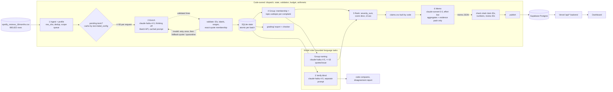

# Spotify Review Insights: a multi-agent review-to-recommendation pipeline

**Question.** At the end of the May 2022 to Nov 2023 review window, where should Spotify put next quarter's product effort: access, usability, playback, or billing/support?

**Answer (from the saved full run).** {{RECOMMENDATION}} See the decision memo, [`grading/memo.md`](grading/memo.md). Every issue-level number in it cites a claim ID from [`grading/claims.csv`](grading/claims.csv), which code recomputes from saved records.

- **Live dashboard:** **https://spotify-reviews-gdl.vercel.app**. Public, no login, no API key. Its `/api/*` backend (Vercel serverless functions) reads the processed data from a **Supabase Postgres** database.
- **Grading export:** [`grading/`](grading/), in the format of `GRADING_CONTRACT.md`. The self-check result is shown [below](#self-check-zero-api).
- **Cost calculator:** [`cost/`](cost/). The default mode is an offline replay, and the report is [`cost/report.md`](cost/report.md).

> **Scope (instructor-approved).** The final run classifies the **first 100,000 nonempty reviews in the course manifest's seeded SHA-256 sample order**. That scope contains the golden 50, the 10K, 500 and 100 development sets, and 78,099 distinct texts. Exact-text reuse then completes **every other review in the 660,622-row file whose text is identical to a classified text**. All 660,622 IDs are accounted for in `grading/records.jsonl`. The 13 empty texts are quarantined as `empty_review_text`. The remaining rows are quarantined as `not_in_declared_classification_scope`, and they are **not** completed classifications.

## Results summary (measured unless marked *estimate*)

| | |
|---|---|
| Source rows ingested and accounted for | {{SOURCE_ROWS}} (checksum `1fc85de6…cef6` matches the manifest) |
| Completed classifications | **{{COMPLETED}}** ({{COMPLETED_PCT}} of rows; {{COMPLETED_PCT_NONEMPTY}} of 660,609 nonempty) |
| … of which inside the declared 100K scope | {{COMPLETED_IN_SCOPE}} of 100,000 |
| … of which completed by exact-text reuse (`cache_source_id`) | {{REUSE}} |
| Quarantined | {{QUARANTINED}}: {{QUARANTINE_REASONS}} |
| Model-stage failures still unresolved | {{UNRESOLVED}} |
| Golden-50 agreement (topic / intent / severity exact; severity MAE) | {{GOLD_LINE}} |
| Blind verifier on a seeded 1% sample | {{VERIFY_LINE}} |
| Prompt-injection test (8 synthetic) | {{INJECTION_LINE}} |
| Planted-error test copy | {{PLANTED_LINE}} |
| 100-review pilot (cold → warm) | {{PILOT_LINE}} |
| Total measured API spend (all runs, all stages) | **{{TOTAL_SPEND}}** (ledger; usage × dated rates in `cost/rates.csv`) |
| Final run wall clock | {{FINAL_WALL}} |
| *Estimate*: full 660,609 run at measured batch rates | {{FULL_ESTIMATE}} (over the ~$10 project budget, which is why the scope was capped) |

## Rubric → evidence map

| Rubric item | Evidence |
|---|---|
| **D1** Accessible code, setup, artifacts | [Setup](#setup-and-paid-commands), [`requirements.txt`](requirements.txt), [`.env.example`](.env.example), [`grading/`](grading/), [`runs/`](runs/), release asset with the full records |
| **D2** Architecture, shared schema, provenance | [Architecture](#architecture), [`labels/LABELS.md`](labels/LABELS.md), [`prompts/`](prompts/), `label_config` on every record and call, [`artifacts/data_manifest.json`](artifacts/data_manifest.json), [`grading/run.json`](grading/run.json) |
| **D3** Memo numbers ↔ calculations ↔ evidence | [`grading/memo.md`](grading/memo.md), [`grading/claims.csv`](grading/claims.csv), [`runs/final_100k/memo.json`](runs/final_100k/memo.json) (code check result), [trace of one review](#one-review-traced-end-to-end) |
| **D4** Recommendation, alternatives, limitations | memo sections "Alternatives considered" and "Risks and limitations"; [memo review](#review-of-the-ai-memo-against-saved-data); [Limitations](#limitations) |
| **T1** 50 labels, per-field comparison, error analysis | [`evals/golden_eval.md`](evals/golden_eval.md), [`evals/golden_cases.csv`](evals/golden_cases.csv), [`evals/golden_50_labeled.csv`](evals/golden_50_labeled.csv), [error analysis](#error-analysis) |
| **T2** Independent verification, planted errors, injection | [`runs/final_100k/verify/`](runs/final_100k/verify/), [`evals/injection/results.json`](evals/injection/results.json), `verify/planted_errors.json` |
| **T3** Pilot, calculator, retry/spend/recovery controls | [`cost/report.md`](cost/report.md), [`cost/calculator.py`](cost/calculator.py), [`cost/README.md`](cost/README.md), [controls](#controls-retry-spending-recovery), [`evals/controls/controls_test.json`](evals/controls/controls_test.json) |
| **W1** Ingestion, coverage, classification | [`artifacts/ingestion_report.json`](artifacts/ingestion_report.json), [`grading/ingestion.json`](grading/ingestion.json), [self-check](#self-check-zero-api) |
| **W2** Staged program, bounded calls, handoffs, resume | [`pipeline/`](pipeline/), [`grading/calls.jsonl.gz`](grading/calls.jsonl.gz), [resume evidence](#interruption-and-resume) |
| **W3** Reproducible ranking, deployed dashboard with DB and AI recommendation | `python -m pipeline rank` ([below](#reproduce-without-api-calls)), https://spotify-reviews-gdl.vercel.app, [`db/schema.sql`](db/schema.sql), [`dashboard/`](dashboard/) |

## Architecture



| Stage | Owner | Input → output (saved handoff) | Failure behavior / stop rule |
|---|---|---|---|
| 1 Ingest | code | CSV → `source` table, `ingestion_report.json`, `data_manifest.json`, scope queue | malformed CSV aborts; empty text is quarantined |
| 2 Enrich | `claude-haiku-4-5` | ≤50 distinct texts as numbered lines → `i\|subtopic\|intent\|sentiment\|severity\|needs_review\|quote` → `results` | an invalid item gets 1 retry; then a deterministic first-sentence quote with `needs_review`, or quarantine; 429/5xx get 4 retries with backoff and jitter; the spend cap stops admission |
| 3 Verify | `claude-haiku-4-5` (separate prompt, never sees the first label) | seeded 1% sample (≤1,000) → `verify/comparison.csv`, `disagreements.csv` | failed batches are logged; code computes agreement |
| 4 Group | code (membership), `claude-haiku-4-5` (names) | completed complaint and cancellation records → `membership.csv`, `issues.json` | names are cached by evidence hash; unknown IDs from the model are rejected |
| 5 Rank | code only | `records` + `membership.csv` → `ranking.csv`, `aggregates.csv`, `topic_rollup.csv` | deterministic; `python -m pipeline rank` |
| 6 Memo | `claude-sonnet-5-5` | ranking top 12 + topic roll-up + claims + evidence pack (≤3 quotes for each of the top 8 issues) → `memo.json`, `memo.md` | code rejects unknown claim or review IDs and mismatched numbers; 1 corrective retry |

**Why each model call exists.** Topic, intent and severity need reading messy, multilingual and sarcastic text, so a small model does it in bulk (Haiku 4.5, no thinking, compact line output). Verification has to be independent of the enricher, so it uses a separate prompt that never sees the first label. Issue names need a short language summary, but membership does not, so code decides membership. The memo needs a judgment comparing alternatives, so it uses the one stronger-model call. **Code does everything else**: dedup, caching, scope, validation, quote membership, entity extraction (explicit feature terms), grouping, arithmetic, ranking, claim checks, the database load and record accounting.

## Shared labels and schema
Topics, intents, severity and examples: [`labels/LABELS.md`](labels/LABELS.md) (the contract definitions plus our subtopics and worked examples). Prompts: [`prompts/enrich_v3.md`](prompts/enrich_v3.md) (frozen), [`verify_v1`](prompts/verify_v1.md), [`group_v1`](prompts/group_v1.md), [`memo_v1`](prompts/memo_v1.md).
`label_config` = `{{LABEL_CONFIG}}` (model + prompt version@sha256-prefix + schema version). It is stored on every record and every enrich call, and it is part of the cache key.

## One review traced end to end
{{TRACE}}

## Error analysis
{{ERROR_ANALYSIS}}

**Blind-verifier disagreement breakdown** ([`disagreement_breakdown.json`](runs/final_100k/verify/disagreement_breakdown.json), n=781):
- The largest topic disagreement is **billing → usability (21 cases)**. Of 91 sampled complaints labeled billing, the verifier agreed on 59 (65%). Only 3 of 96 usability complaints moved the other way. Both prompts carry the contract rule that explicitly premium-only controls are billing, but "locked behind premium" is often implied rather than stated, and the two roles read that differently.
- The next most common intent disagreements are complaint → request (24) and complaint → unclear (14).
- Severity disagreements are symmetric: the verifier was lower 63 times and higher 71 times. That shows no systematic severity bias.

**Main error pattern.** The enricher falls back to `other` when a positive or short review names a feature in passing ("very diverse", "very less advertising", "No ads at all"). The golden labels instead use the first praised feature. This affects praise records, which never enter the complaint ranking. Among complaints, the blind verifier's disagreements concentrate on two boundaries: **billing vs usability** for restricted controls (as in the traced review above, billing vs usability) and **cancellation vs complaint**. Both move counts between neighboring top issues, so the memo pairs the paywall and ads issues instead of treating their order as precise.

## Review of the AI memo against saved data
The memo's priority, **billing / premium paywall, scoped together with ads**, follows the saved baseline ranking, and its numbers match `claims.csv`. Read with the verifier breakdown above, the robust finding is the shared theme: **free-tier restrictions (paywalled basic controls plus ad load)** lead whether the boundary cases count as billing or usability:
- Taking the paywall and ads issues together: 15,879 complaints, priority 40,492 (rank 2 + rank 3 in `grading/ranking.csv`).
- The next specific issue, playback crashes, has priority 6,534.

The exact billing-vs-usability split is not. If a third of paywall complaints moved to usability, as the verifier sample suggests, usability would lead the roll-up and billing would come second. The product action is unchanged: revisit which controls the free tier locks and how ads interrupt listening. Playback stability is the strongest alternative, with fewer complaints but higher severity (mean 3.64 for crashes). Access is the most severe per complaint (3.88) but small.

## Interruption and resume
- **Recording:** [`evals/resume/resume_demo.typescript`](evals/resume/resume_demo.typescript), a real terminal session recorded with macOS `script -r`. Replay it with `script -p evals/resume/resume_demo.typescript`.
- **What happened:** the 1,000-review in-scope slice [`evals/resume/resume_demo_1000.csv`](evals/resume/resume_demo_1000.csv) was started. SIGINT (Ctrl-C) was sent after the 7th saved request. The **identical command** then resumed it.
- **Checkpoints:** [`grading/checkpoint_before.json`](grading/checkpoint_before.json) holds 455 completed IDs and [`grading/checkpoint_after.json`](grading/checkpoint_after.json) holds 999. The resume phase made 15 enrich calls, and **0 already-completed IDs were re-sent**.
- **Batch path:** a second interruption happened in the 10K batch run while a provider batch job was in flight. On restart, the saved job ID was reconciled (results fetched) instead of resubmitted. See `runs/analysis_10000/run_log.jsonl`.
- **First-attempt bug (honest note):** the first demo attempt did not actually interrupt. Background jobs in a non-interactive shell ignore SIGINT, so the 500 run completed normally. The fix restores the default SIGINT handler at startup, and that run remains valid as the 500 checkpoint.

## Controls: retry, spending, recovery
- **Spend cap:** a hard **$9.00** cap is enforced by a shared ledger (`pipeline/llm.py: Ledger`). Each call or batch job **reserves worst-case cost before dispatch**, and nothing new is admitted when spent + reserved + next > cap (`BudgetExceeded`, which saves state and exits). The calculator shows which scenarios exceed the budget.
- **Bounded batches and output:** ≤50 reviews per request, and an output cap of 2,000 tokens per enrich request.
- **Bounded retries:** 429/5xx/connection errors get up to 4 retries with exponential backoff and jitter. Every failed attempt is logged with `outcome:"failed"`. Timeouts are flagged as "charge unknown".
- **Invalid output:** invalid model output gets **exactly one** retry (smaller requests), then a deterministic fallback or quarantine. *Observed failure:* in the 10K batch run, a bug re-batched invalid items more than once (2 extra small jobs, about $0.05). It was fixed before the 100K run (`enrich.run_batch`, the `retrying` set).
- **Recovery:** the atomic per-batch transaction covers results and the call row together. Provider batch IDs are saved before waiting. On restart, completed texts are skipped under the same `label_config`.
- **Billing reconciliation:** the Anthropic account reported "credit balance too low" when the local ledger stood at **$5.64**. The ledger is usage × listed rates, so the account bill may differ (provider-side batch accounting, or credit already spent outside this project). The run stopped cleanly, and after credit was added it resumed with **no completed text re-sent**. Treat the ledger total as an estimate until it is checked against the console usage page.
- **Zero-cost controls test** ([`tests/controls_test.py`](tests/controls_test.py) → [`evals/controls/controls_test.json`](evals/controls/controls_test.json); fake client, synthetic):
  - With a $0.02 cap, admission stopped after 1 request (spent $0.004 + next worst case $0.018 > cap). Saved work was kept.
  - Two synthetic 429s were each logged as failed attempts, and the request succeeded on attempt 3.
  - A disallowed label got exactly one retry, then was quarantined (`label_not_allowed`, attempts=2).
- **Stronger-model fallback:** the quota was declared at 2% and **0 was used**. The single retry plus the deterministic fallback quote resolved invalid items, so no case justified paying Sonnet rates.

## Self-check (zero API)
{{SELFCHECK}}

## Reproduce without API calls
```bash
python3 -m venv .venv && .venv/bin/pip install -r requirements.txt
# place the course CSVs in "Final Assignment - Spotify Reviews Dataset/" (sha256 1fc85de68a304dd8978b537cfa58793d5f41cbaf417fa32cb53899f83a2fcef6)
gunzip -k grading/records.jsonl.gz                       # if you want the plain file
.venv/bin/python -m pipeline rank --grading grading --out /tmp/ranking.csv && diff /tmp/ranking.csv grading/ranking.csv && echo identical
.venv/bin/python cost/calculator.py                      # offline cost/runtime replay from saved usage + cost/rates.csv
.venv/bin/python evals/golden_eval.py --records runs/final_100k/records.jsonl   # needs the release-asset records (see below)
python3 check_submission.py profile --full "Final Assignment - Spotify Reviews Dataset/spotify_reviews_18months.csv" --out /tmp/ingestion.json
python3 check_submission.py reference --full "Final Assignment - Spotify Reviews Dataset/spotify_reviews_18months.csv" --analysis "Final Assignment - Spotify Reviews Dataset/spotify_reviews_18months.csv" --out /tmp/ref.json
python3 check_submission.py check --reference /tmp/ref.json --submission grading --gold evals/gold_benchmark.json --out /tmp/self-check.json
```
The full per-run `records.jsonl` files are too big for git. The final run's records are in `grading/records.jsonl.gz`, and the GitHub release asset holds `final_100k_outputs.tar.gz`.

## Setup and paid commands
```bash
cp .env.example .env   # fill ANTHROPIC_API_KEY only for paid commands; never commit .env
# 100-review pilot (paid, explicit): cold then warm
.venv/bin/python cost/calculator.py pilot --yes
# any input CSV, all stages (paid):
.venv/bin/python -m pipeline run --input path/to/reviews.csv --out runs/my_run [--scope N | --subset ids.csv] [--batch-api]
# the final run:
.venv/bin/python -m pipeline run --input "Final Assignment - Spotify Reviews Dataset/spotify_reviews_18months.csv" --scope 100000 \
  --db state/pipeline.db --out runs/final_100k --run-id final100k --batch-api --requests-per-job 400 --verify-max 1000
.venv/bin/python -m pipeline grading --run-dir runs/final_100k --db state/pipeline.db --input "<full csv>" --out grading --checkpoints evals/resume --gzip
.venv/bin/python -m pipeline publish --run-dir runs/final_100k --db state/pipeline.db   # loads Supabase (db/loader_open.sql first)
```
Dependencies (pinned): {{DEPS}}. Python 3.14; the dashboard is static HTML plus Node serverless functions (no npm dependencies).

**Dashboard and database.** Supabase project `spotify-review-insights` (Postgres). The schema is [`db/schema.sql`](db/schema.sql), with public read-only row-level security. The Vercel functions in [`dashboard/api/`](dashboard/api/) query it server-side using `SUPABASE_URL` and `SUPABASE_PUBLISHABLE_KEY` from Vercel environment variables. The browser never talks to the database directly. The **AI recommendation** panel shows the saved Sonnet memo. Clicking a claim ID shows the code-computed value and its issue, and clicking a review ID shows the saved source review.

## Development history (measured checkpoints)
- 100 (cold/warm pilot) → 500 → 1K resume demo → 10K (Batch API) → 100K final. See the refresh table in [`cost/report.md`](cost/report.md).
- **Prompt iterations before freezing**, each one measured:
  - `enrich_v1`/`v2` used JSON output, at about 37–50 output tokens per review.
  - `enrich_v3` uses compact line output, at about 20 tokens per review, with a ≥4,096-token cached system prompt.
  - `enrich_v3` was **frozen before anyone read the golden reviews**.

## Golden-set provenance (disclosure)
The golden 50 labels were **drafted by Claude Opus 5.5** (the coding assistant, not a pipeline model). They were then **reviewed one by one by the student** in `tools/review_golden.py`, who accepted all 50 drafts unchanged (`human_changed=n`, `label_source=assistant_draft_human_accepted` in every row). The labels were never pipeline inputs, and the enrich prompt was frozen before drafting. Because the reviewer made no corrections, golden agreement partly measures consistency between two Claude models, not independent human judgment. Treat it as a diagnostic.

## Limitations
- **Population:** these are self-selected public Google Play reviews (May 2022 to Nov 2023), not a customer population. There is no revenue, plan tier or confirmed churn. Cancellation language is stated intent.
- **Partial classification:** {{COMPLETED_PCT_NONEMPTY}} of nonempty reviews are classified. Out-of-scope rows are excluded from all counts. The 100K scope is a uniform seeded sample, but the reuse-completed rows are skewed toward short, repeated texts ("good", "nice app"), which are mostly praise.
- **Label error:** blind-verifier agreement is moderate. The usual confusions are billing vs usability (premium-locked controls), cancellation vs complaint, and "other" vs a specific topic.
- **Quotes:** {{FALLBACK_QUOTES}} long reviews use a deterministic first-sentence quote after the model's quote failed exact-substring validation twice. These are flagged `needs_review`.
- **Time periods:** the first and last months are partial. Trend shares on the dashboard report their denominators.
- **Injection:** the model resisted all 8 synthetic injections but flagged none of them for review, so `needs_review` is not a reliable injection detector.
